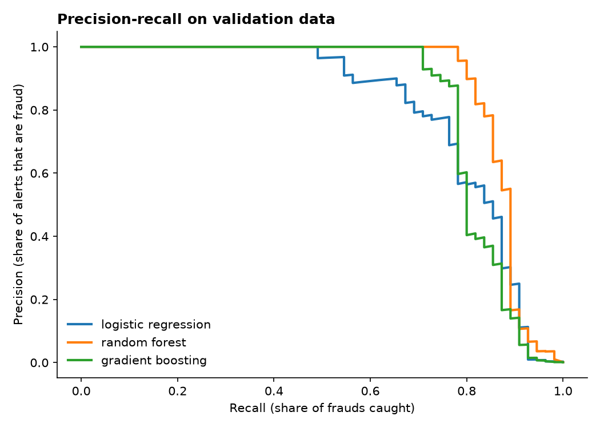

# Cost-Aware Credit Card Fraud Detection


A machine learning pipeline that detects fraudulent card transactions in a dataset where **only 0.17% of
transactions are fraud**. It picks its alert threshold by minimising **dollars lost**, not by maximising accuracy.

**Stack:** Python · scikit-learn · pandas · matplotlib · pytest · GitHub Actions

## Why accuracy is the wrong metric here

A model that says "never fraud" is 99.83% accurate and useless. This project instead measures:

- **PR-AUC** (precision-recall area), which shows how well the model ranks fraud above normal transactions.
- **Precision:** of the transactions we flag, how many really are fraud (each alert costs an analyst's time).
- **Recall:** of all fraud, how much we catch.
- **Net savings in dollars:** fraud stopped minus the cost of reviewing alerts.

## Results

Models are trained on the **earliest 70%** of transactions, the alert threshold is tuned on the next 15%,
and they are scored once on the **final 15%**, which nothing touched during development.

**Validation (choosing the model):**

| Model | PR-AUC | Recall | Precision | Net savings | Train time |
|---|---|---|---|---|---|
| Logistic regression (class-weighted) | 0.803 | 0.84 | 0.53 | $7,803 | 4 s |
| **Random forest (class-weighted)** | **0.874** | 0.82 | **0.83** | **$7,962** | 387 s |
| Histogram gradient boosting | 0.820 | 0.85 | 0.37 | $7,357 | 147 s |

**Held-out test set, random forest:**

| Metric | Value |
|---|---|
| PR-AUC / ROC-AUC | 0.782 / 0.952 |
| Frauds caught | 39 of 52 (recall 75%) |
| Alerts raised | 51, of which 76% were fraud |
| Fraud dollars stopped | $3,796 of $6,169 (62%) |
| Net savings after $5/alert review cost | $3,541 |

Performance drops from validation to test. That's expected with time-ordered data: fraud patterns shift,
and the test window holds only 52 frauds. A random split would have hidden this, which is why the project doesn't use one.



## Design decisions

- **Split by time, not at random** ([`data.py`](src/fraud/data.py)). It mirrors production, where you train on the past and predict the future,
  and it avoids leaking future patterns into training. About 1,000 duplicate rows are removed first so they can't appear on both sides of the split.
- **Feature engineering inside the pipeline** ([`features.py`](src/fraud/features.py)): log amount, an amount z-score,
  time of day as sine and cosine (so 23:59 sits next to 00:00), and a $0-authorisation flag (a common card-testing pattern).
  It is a scikit-learn transformer, so exactly the same features are computed when the model is served.
- **Class weights instead of oversampling**, which keeps predicted probabilities meaningful for threshold tuning.
- **Cost-based threshold** ([`evaluate.py`](src/fraud/evaluate.py)). A missed fraud costs its amount, and each alert costs `--review-cost`
  ($5 by default). The threshold that minimises total cost is chosen on validation data only.
- **Explainability:** permutation importance on a fraud-enriched sample shows which inputs the model relies on
  (`artifacts/top_features.png`).

## Run it

```bash
pip install -e ".[dev]"
# download creditcard.csv from Kaggle into data/
fraud-train data/creditcard.csv --out artifacts            # trains, compares, saves model + metrics
fraud-predict artifacts/model.joblib new_transactions.csv  # scores new data, writes scored.csv
pytest -q                                                  # 5 tests on synthetic data, no download needed
```

## Data

[Credit Card Fraud Detection](https://www.kaggle.com/datasets/mlg-ulb/creditcardfraud) by the Machine Learning Group, Université Libre de Bruxelles (ULB), on Kaggle (Database Contents License).
It holds 284,807 European card transactions from September 2013. Features `V1`–`V28` are PCA components released for confidentiality.
The 144 MB CSV is not committed.

---

Built by Neria Fay Arinda, with help from Claude (Anthropic) as a coding assistant.
